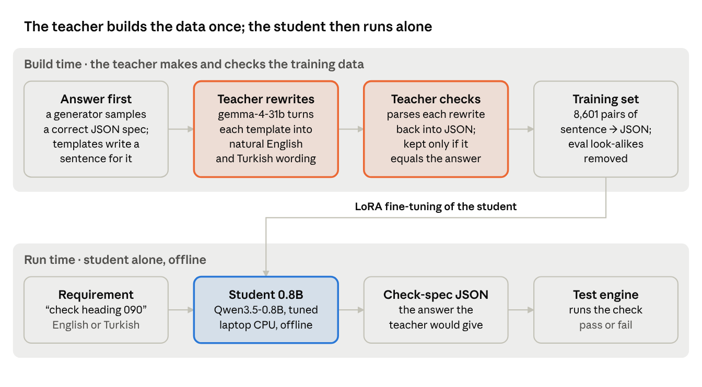

# How to Fine-Tune an LLM

Nov 4, 2026

## Introduction

Fine-tuning means continuing to train a pretrained language model on your own examples so that it reliably performs one task in one format. Use it when you need a narrow skill to run fast, cheaply or offline, and prompting a large model is too slow, too costly or not allowed.

The three common ways to adapt an LLM solve different problems:

| Approach | What it changes | Best for | Weakness |
| --- | --- | --- | --- |
| Prompting | Nothing; instructions and examples go in the context | Fast experiments, broad tasks on a large model | Long prompts cost latency; small models follow them poorly |
| RAG (retrieval) | What the model knows at answer time | Facts that change, citing documents | Does not teach a new behaviour or output format |
| Fine-tuning | The model's weights | A fixed behaviour, format or style; making a small model do a big model's job | Needs data, training compute and an evaluation set |

For edge AI, fine-tuning is the main tool. A 0.5–2B model knows little out of the box, but trained on one task it can match a 30B+ model on that task while running on a laptop CPU. The model gives up general knowledge in exchange for size and speed on the task you care about.

## Core concepts

Most practical fine-tuning is supervised fine-tuning (SFT) with LoRA on top of an instruction-tuned base model. The terms below are the ones you meet when setting this up.

- **Pretraining**: training from scratch on trillions of tokens. You will not do this; you start from a released checkpoint.
- **Supervised fine-tuning (SFT)**: training on (prompt, ideal answer) pairs. The loss is computed only on the answer tokens (*completion-only loss*), so the model learns what to say, not how to repeat the prompt.
- **Preference tuning (DPO, RLHF)**: training on pairs of a better and a worse answer. It is useful for tone and safety; for structured outputs with one correct answer, SFT is enough.
- **Full fine-tuning**: every weight is updated. It gives the best quality, but needs several times the model size in GPU memory.
- **LoRA**: the base weights are frozen and small low-rank matrices are trained beside them, usually under 1% of the parameters. Rank `r` sets their capacity (8–64 is typical). After training, the adapter is merged into the base model.
- **QLoRA**: LoRA on a base model loaded in 4-bit, so that 7–13B models fit on one consumer GPU.
- **Distillation**: a large *teacher* model produces or checks the training labels, and a small *student* learns to imitate it on the task. This is how a 31B model's skill ends up in a 0.8B model.
- **Quantization**: storing weights in 4–8 bits after training (for example GGUF Q4_K_M), shrinking the model about 4× with little loss in accuracy.

## Step-by-step process

A fine-tuning project is mostly data and evaluation work; the training run itself is the shortest step. Build the evaluation first, so that every later decision is measured.

1. **Define the task and the success criterion.** Write down the input, the exact output format and a measurable target (for example "≥ 78 of 80 cases correct, < 2 s on CPU").
2. **Build a frozen evaluation set.** Use real cases with known correct answers, plus a grader script that checks them automatically. Never train on these cases.
3. **Measure baselines.** Score the large teacher model, any existing rule-based solution and the untuned candidate small models. This tells you whether fine-tuning is needed and which base model to start from.
4. **Choose the base model.** Pick the smallest instruction-tuned model that fits your runtime limits. Check that it has a permissive license, that its chat template works with your tools, and that it converts to your deployment format.
5. **Create the training data.** Thousands of (input, ideal output) pairs that cover the variety of the real inputs. See the Data section.
6. **Train with LoRA.** Start with 2 epochs, learning rate around 2e-4 and rank 16, and watch the validation loss.
7. **Merge, convert and quantize.** Merge the adapter into the base weights, then convert to the runtime format (for example GGUF Q4_K_M for llama.cpp).
8. **Evaluate the quantized model** on the frozen set, in the same runtime you will deploy. Read every failure, not only the score.
9. **Iterate on the data.** Most failures trace back to inputs the training data never showed. Add targeted examples and retrain. Change hyperparameters only when the data is right.

## Data

The quality and coverage of the training data decide the result more than any hyperparameter. When real labelled data is scarce, synthetic data checked by a teacher model works well for structured tasks.

- **Generate the answer first, then the question.** Sample a correct output (the *skeleton*) from the task's own vocabulary, then render input text for it from templates. Every label is then correct by construction.
- **Add variety with an LLM paraphraser.** Ask a large model to rewrite each templated input in several natural styles and languages. Templates alone teach the model the templates.
- **Filter with a round trip.** Give each paraphrase to the teacher model, then validate and grade its answer against the skeleton. Keep a row only when they match exactly. This removes paraphrases that changed the meaning.
- **Check that labels are self-consistent.** Run every label through the same validator and grader used at evaluation time, and drop any row that fails.
- **Prevent evaluation leaks.** Remove training rows that duplicate or nearly duplicate an evaluation case (for example a trigram Jaccard similarity ≥ 0.8 on normalised text).
- **Split validation by group.** Keep all paraphrases of one skeleton on the same side of the train/validation split; otherwise validation loss is too optimistic.
- **Keep targets short.** Use a one-line system prompt and compact output (default values omitted). Shorter targets train faster and run faster.
- **Make the model copy, not compute.** Small models are poor at arithmetic. Let the model emit values as written ("463 km/h") and convert them in ordinary code afterwards.

## Hardware and tooling

LoRA on models up to about 3B parameters fits on a single 16 GB GPU. The machine that runs the finished model only needs a CPU.

| Need | Option | Notes |
| --- | --- | --- |
| Training GPU | One 16 GB GPU (for example an NVIDIA T4) | Enough for LoRA on models up to ~3B; A100/H100-class GPUs for ~7B and above |
| Training libraries | Hugging Face `transformers`, `peft` (LoRA), `trl` (`SFTTrainer`) | `SFTTrainer` handles chat templates and completion-only loss |
| Conversion and runtime | `llama.cpp`: `convert_hf_to_gguf.py`, `llama-quantize`, `llama-server` | `llama-server` exposes an OpenAI-compatible API with JSON-schema constrained output |
| Teacher model | Any large model behind an API | Writes paraphrases and checks labels; it is never shipped |

On a T4, use fp16 (it has no bf16 support) and enable gradient checkpointing to save memory.

## How distillation works

In distillation, a large *teacher* model creates or checks the training data. A small *student* model is then fine-tuned on that data until it gives the teacher's answers on one task.

1. **Pick a teacher** that already solves the task, often with a long and detailed prompt.
2. **Collect inputs**: real examples, plus synthetic ones that cover the variety of real inputs.
3. **Label them with the teacher.** Either the teacher answers each input, or a correct answer is generated first and the teacher writes inputs for it and confirms that they still lead to that answer.
4. **Filter.** Keep only labels that pass automatic checks, and drop anything that looks like an evaluation case.
5. **Train the student** with SFT on the (input, answer) pairs and a one-line prompt. The long instructions the teacher needed are now learned into the student's weights.
6. **Compare student and teacher** on the frozen evaluation set, and add data wherever the student fails.

A small model cannot hold a large model's general knowledge, but one task needs only a small slice of it. Thousands of worked examples teach the student that slice directly, so it needs no long prompt and answers much faster.

There are two forms of distillation:

- **Hard-label distillation** trains on the teacher's text outputs. It works with any teacher, including one behind an API, and is what the use case below uses.
- **Soft-label (logit) distillation** trains the student to match the teacher's probability for every token. It carries more information per example, but needs access to the teacher's logits and usually a shared tokenizer.

## Use case: a 0.8B model that writes display test specs

We distilled a 31B model's requirement-translation skill into Qwen3.5-0.8B. The fine-tuned model scores 79/80 on the evaluation set, against 80/80 for the 31B teacher and 63/80 for the existing rule parser. It runs offline as a 529 MB GGUF file.

### The task

An internal test tool tests a cockpit flight display in a simulator. It turns a test requirement written in plain English or Turkish into a JSON check-spec that a test engine can run. For example, "SRS-DSP-0142: The flight display shall indicate a magnetic heading of 090° within ±2°." becomes `{"requirement_id":"SRS-DSP-0142","checks":[{"param":"heading","op":"eq","expected":90,"tol":2}]}`. The spec covers flight values (altitude, airspeed, Mach, roll, pitch), autopilot (FMA) mode annunciations, comparisons, ranges, tolerances, and a status for requirements that cannot be checked (unsupported, partial, needs clarification).

The teacher is needed only while the training data is built: it writes natural wording and rejects any rewrite that changes the answer. At run time the student turns each requirement into JSON on its own, on the laptop and without a network.

The parser used gemma-4-31b through an API. The goal was a model that:

- scores ≥ 78/80 on the tool's 80-case evaluation set;
- answers in under about 2 s on a laptop CPU (Intel Core Ultra 7 265U, 32 GB, no NVIDIA GPU);
- has at most 2B parameters and runs fully offline.

A second set of 150 Turkish requirements was written as a holdout; Turkish support was a secondary goal.

### Results

Untuned small models, given the full instructions prompt, were far from the target. Qwen3.5-2B was no better than 0.8B, so the smallest model was kept.

| Model | Fine-tuned | Eval (80) | Turkish holdout (150) | Median latency |
| --- | --- | --- | --- | --- |
| gemma-4-31b (teacher, API) | No | 80 | – | – |
| Rule-based parser | – | 63 | – | – |
| Qwen3.5-0.8B | No | 29 | 25 | 5.9 s (laptop) |
| Qwen3.5-2B | No | 28 | 32 | 7.8 s (laptop) |
| Gemma 4 E2B | No | 58 | 80 | 9.8 s (laptop) |
| Gemma 4 E2B | Yes | 74 | 147 | 8.6 s (server CPU) |
| **Qwen3.5-0.8B** | **Yes** | **79** | **148** | **2.7 s (server CPU)** |

All local models ran as Q4_K_M GGUF in llama.cpp with JSON-schema constrained output. Laptop and server latencies are not directly comparable, and the shared server's speed varied by about 50% between runs.

### Training data

The final set holds 8,601 training and 451 validation examples, 37% of them Turkish. It was built with the method in the Data section:

1. A generator samples a correct spec from the tool's parameter catalog and renders English and Turkish text from templates (3,747 rows in the final set).
2. gemma-4-31b paraphrases them into natural wording. Each paraphrase is parsed back by the same model and kept only if the result grades exactly equal to the original spec (3,102 English and 1,752 Turkish paraphrases in the final set).
3. Duplicates (96), near-copies of evaluation or holdout cases (8) and rows that taught pre-converted unit values (187) were dropped.
4. The target is a one-sentence system prompt plus compact JSON (median 113 characters).

## What we learned

Distillation turned a 0.8B model into a near copy of the 31B teacher for this task: 79 of 80 correct against the teacher's 80, from a model about 39× smaller that answers in seconds on a laptop CPU with no network.

- **Near-teacher accuracy from a tiny model.** Fine-tuning took Qwen3.5-0.8B from 29/80 to 79/80, one case short of gemma-4-31b and 16 cases above the rule-based parser. On the Turkish holdout it went from 25/150 to 148/150.
- **Faster answers.** Untuned, the model needed the long instructions prompt, took 5.9 s on the laptop and got most cases wrong. Tuned, it needs only a one-sentence system prompt instead of the long instructions, and it writes a short JSON answer of about 30 tokens. On a shared CPU server its median answer took 2.7 s.
- **Small enough to run anywhere.** The quantized student is a single 529 MB file and runs on a CPU. A 31B model must read about 39× more weights for every token it writes, so in practice it needs a GPU server or a paid API.
- **Local and offline.** Asking the teacher means a network round trip, an API key, a per-call cost and sending the requirements outside the machine. The student needs none of these: the data stays on the laptop, and it works without a connection.
- **The teacher is used once, at build time.** gemma-4-31b wrote the paraphrases and checked every training label. After training, the student works alone; the teacher can stay as an optional fallback for rare inputs.
- **Task-specific training beats model size.** Untuned, the 2B model scored 28/80, no better than 0.8B. Tuned on the same data, Gemma 4 E2B reached 74/80 but was about three times slower. The skill comes from the training data, not the parameter count.
- **Better data, not bigger models, closed the last gap.** The last few points came from reading the failures and adding targeted examples, such as letting the model copy units and leaving the arithmetic to code.

## Conclusion

Distillation is the right tool when you need one narrow skill done the same way thousands of times, fast, cheaply and locally. A large model already does such a task well; the small model only has to learn that one skill, so it can match the large one at a fraction of the size.

The use case had every property that makes distillation work. Check these before starting a new project:

- **Narrow task.** One kind of input, one job; no open-ended conversation or broad world knowledge.
- **Fixed output format.** JSON, a label, a command or a short structured answer that code can check.
- **A teacher that already succeeds.** A large model, or a large model with a long prompt, gets the task right; you are compressing a skill that exists.
- **Automatic checking.** A validator or grader can tell a correct output from a wrong one, so synthetic data can be filtered and the student scored.
- **Many calls, or strict runtime limits.** High volume, low latency, no network, no per-call cost, or data that must not leave the device.

### More tasks that suit distillation

| Task | Input → output | Why a distilled small model fits |
| --- | --- | --- |
| Requirement classification and quality checks | Requirement sentence → type, testability, ambiguity flags | Fixed label set; runs over thousands of requirements; documents stay in-house |
| Test-step generation in a house format | Requirement → test steps or script in a company DSL | One output grammar a parser can validate; the teacher shows the style once |
| Structured extraction from documents | Test report, datasheet or form → JSON fields | Same schema every time; checkable against the source text; confidential files stay local |
| Log and fault-message triage | Log line or maintenance note → fault code, subsystem, severity | Very high volume; small closed label set; can run on the equipment itself |
| Natural language to a query or command | Question → SQL for a known schema, or voice phrase → device command | Output is executable and testable; must answer in well under a second |
| Ticket and bug routing | Ticket text → team, component, priority | Many items a day; labels come from past tickets checked by the teacher |
| Domain translation with a glossary | Turkish technical text → English with fixed terminology | A narrow vocabulary the teacher can enforce; no cloud translation of sensitive text |
| On-device intent and slot filling | User utterance → intent + parameters | Embedded or offline hardware; tight memory and latency budgets |

Distillation is the wrong tool for open-ended reasoning, broad question answering or facts that change often. There, a large model, or retrieval (RAG) on top of one, stays the better choice. For a well-defined, repeatable task with a checkable answer, a distilled small model gives large-model accuracy with the speed, cost and privacy of running locally.
